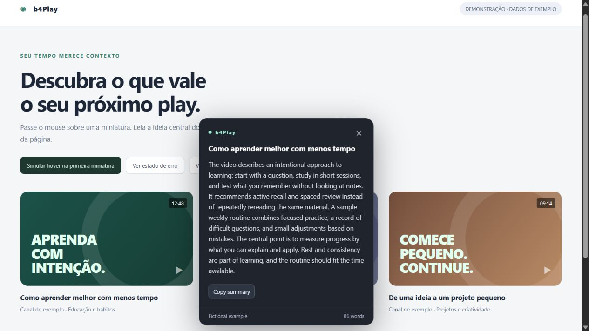

# b4Play

**English** · [Português (Brasil)](README.pt-BR.md)

Context before your next play. b4Play summarizes YouTube transcripts in **up to 200 words**, on thumbnail hover or from the toolbar button.

> **Security notice:** Microsoft Defender has detected files in version 0.3.0 as `Trojan:Script/Ulthar.A!ml`. The cause is still under investigation. Do not install or distribute these packages until the detection is resolved.

## Downloads — beta 0.3.0

| Browser | Download |
| --- | --- |
| Opera | **[Click here to download the Opera ZIP](https://github.com/MrSeraloc/b4Play/raw/refs/heads/main/downloads/b4play-opera-0.3.0.zip)** |
| Chrome / Chromium | **[Click here to download the Chrome ZIP](https://github.com/MrSeraloc/b4Play/raw/refs/heads/main/downloads/b4play-chrome-0.3.0.zip)** |
| Required local service | **[Download the local service and source](https://github.com/MrSeraloc/b4Play/raw/refs/heads/main/downloads/b4play-service-0.3.0.zip)** |

[SHA-256 checksums](downloads/SHA256SUMS.txt) · [MIT license](LICENSE) · [Privacy](docs/PRIVACY.md) · [Support](https://github.com/MrSeraloc/b4Play/issues)

**This is a developer-mode beta, not an approved store listing.** You need Node.js 22+, a running local service, and your own OpenAI or OpenRouter API key. API use can cost money. There is no developer-operated backend, advertising, or telemetry.

## Install

Once the alert above is resolved, you will need **two files**: your browser ZIP and the local service ZIP. The service runs on your computer and must remain open while you use the extension. The steps below describe this beta's manual installation.

1. Download and extract the ZIP for your browser and the local service ZIP. Keep them in permanent folders.
2. In the extracted service folder, run `node --env-file-if-exists=.env server/index.mjs`. Windows users can also run `iniciar.ps1`. No package installation is required.
3. Open `opera://extensions` or `chrome://extensions`, turn on **Developer mode**, choose **Load unpacked**, and select the extracted browser ZIP folder. `manifest.json` is directly inside it.
4. Open b4Play settings. Copy the token from the service's `data/service-token.txt` into **Local service token**.
5. Choose **Automatic**, **English**, or **Português (Brasil)**. Read and accept the data-processing disclosure. Enable hover summaries if wanted, then choose **Save and connect**.
6. Under **Choose your AI provider**, select OpenAI or OpenRouter, enter your provider API key and exact model ID, and save. The local token and the provider API key are different credentials.
7. Reload YouTube. Hover over a standard video thumbnail or open a video and click the b4Play toolbar button.

The same local service works with both browser packages. Keep it running on `127.0.0.1:8765`; do not start two copies. Each browser extension stores its own connection settings and consent.

## Languages and behavior



*Development demonstration with fictional data; this is not a real Opera review screenshot.*

The interface and summaries support English and Brazilian Portuguese. Automatic mode follows the browser language; other browser languages fall back to English. The selected language is sent to the AI prompt. Cached summaries are kept separate by language; changing language clears the previous cache.

After the hover delay, b4Play opens a Tactiq result tab in the background, waits for its transcript, then closes that tab. It sends the transcript and video title through the authenticated local service to your selected AI provider. Long transcripts are summarized in sections before the final synthesis. The hard output limit is 200 whitespace-separated words.

Use **Check key and model** for a metadata-only credential check. It generates no text. Imported `.txt` transcripts provide a manual path when Tactiq cannot return text.

## Known limitations

- Tactiq is a third-party website, not a supported transcript API integration. Page changes, missing captions, verification failures, or restrictions can stop automatic retrieval. A 403 was observed during the initial investigation. Do not expect every video to work.
- Tactiq's documentation limits its generator to standard English-language videos. An English/Portuguese interface does not add Portuguese transcription support. Shorts are not supported.
- Summaries cover transcript content; they do not analyze visual-only events, charts, or images.
- The current version requires the local Node.js service. It is not a one-click standalone install.
- API keys are stored as local plaintext in `data/ai-config.json` or `.env`. Keep that data private. No user keys or runtime data are distributed in these downloads.
- Store approval and cross-platform browser testing have not been completed. See [Opera readiness](docs/OPERA-READINESS.md).

## Development

```sh
npm run build
npm test
npm run package
npm start
```

No npm dependencies are required. `extension/` is the shared browser source. The build creates `dist/opera/` and `dist/chrome/`; packaging writes the three ZIPs to `downloads/` with reproducible contents and checksums. The Opera package has Opera-sized toolbar icons. The Chrome package declares its minimum Chromium version. Both contain only extension runtime files, locale catalogs, icons, and the MIT end-user license.

`server/` is the common local companion. `shared/` contains validation and translations. Tests use fake provider responses, not real API keys or paid inference.

## Publication

This repository hosts both editions. The download buttons above point directly to versioned ZIPs in `downloads/`, so downloading does not require a GitHub account. These files are different from GitHub's automatic **Download ZIP**, which downloads the source tree.

For official catalog distribution, use the browser ZIP only. Prepare the listing, privacy URL, support URL, screenshots, and reviewer setup instructions from [the publication guide](docs/PUBLISHING.md). The local service and remaining verification work must be clearly disclosed. The project has not been submitted to either store.

Copyright © 2026 MrSeraloc. Distributed under the MIT license. b4Play is an independent project and is not affiliated with Opera, Google, YouTube, Tactiq, OpenAI, or OpenRouter.
