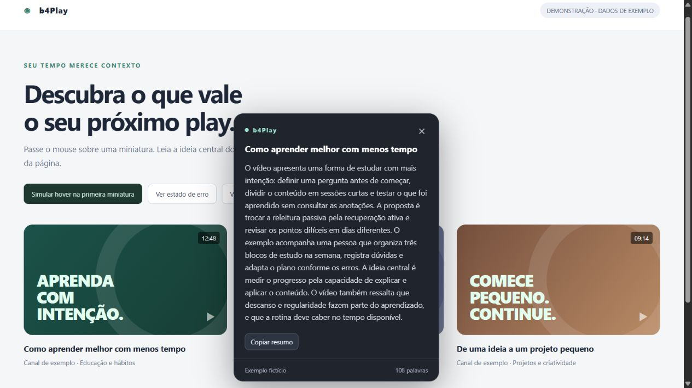

# b4Play

[English](README.md) · **Português (Brasil)**

Contexto antes do próximo play. O b4Play resume transcrições do YouTube em **até 200 palavras**, ao passar o mouse na miniatura ou pelo botão da barra de ferramentas.

> **Aviso de segurança:** o Microsoft Defender identificou arquivos da versão 0.3.0 como `Trojan:Script/Ulthar.A!ml`. A causa ainda está em investigação. Não instale nem distribua estes pacotes enquanto a detecção não for esclarecida.

## Downloads — beta 0.3.0

| Navegador | Download |
| --- | --- |
| Opera | **[Clique aqui para baixar o ZIP para Opera](https://github.com/MrSeraloc/b4Play/raw/refs/heads/main/downloads/b4play-opera-0.3.0.zip)** |
| Chrome / Chromium | **[Clique aqui para baixar o ZIP para Chrome](https://github.com/MrSeraloc/b4Play/raw/refs/heads/main/downloads/b4play-chrome-0.3.0.zip)** |
| Serviço local obrigatório | **[Baixar o serviço local e o código-fonte](https://github.com/MrSeraloc/b4Play/raw/refs/heads/main/downloads/b4play-service-0.3.0.zip)** |

[Verificação SHA-256](downloads/SHA256SUMS.txt) · [Licença MIT](LICENSE) · [Privacidade](docs/PRIVACY.pt-BR.md) · [Suporte](https://github.com/MrSeraloc/b4Play/issues)

**Esta é uma versão beta instalada pelo modo de desenvolvedor, sem aprovação nas lojas.** É necessário ter Node.js 22+, manter o serviço local aberto e usar uma chave própria da OpenAI ou do OpenRouter. A API pode cobrar pelo uso. Não há servidor operado pelo desenvolvedor, anúncios ou telemetria.

## Instalação

Após o esclarecimento do alerta acima, você precisará de **dois arquivos**: o ZIP do seu navegador e o ZIP do serviço local. O serviço inicia no seu computador e precisa ficar aberto enquanto a extensão é usada. As etapas abaixo explicam a instalação manual desta versão beta.

1. Baixe e extraia o ZIP do seu navegador e o ZIP do serviço local. Use pastas permanentes.
2. Na pasta do serviço, execute `node --env-file-if-exists=.env server/index.mjs`. No Windows também é possível executar `iniciar.ps1`. Não é necessário instalar pacotes npm.
3. Abra `opera://extensions` ou `chrome://extensions`, ative **Modo de desenvolvedor**, escolha **Carregar sem compactação** e selecione a pasta extraída do ZIP do navegador. O `manifest.json` fica diretamente nela.
4. Abra as opções do b4Play. Copie o token de `data/service-token.txt` do serviço para **Token do serviço local**.
5. Escolha **Automático**, **English** ou **Português (Brasil)**. Leia e aceite a explicação de envio de dados. Ative o resumo por hover se desejar e clique em **Salvar e conectar**.
6. Na seção **Escolher a IA**, selecione OpenAI ou OpenRouter, cole sua chave de API, informe o ID exato do modelo e salve. O token local e a chave da API são credenciais diferentes.
7. Recarregue o YouTube. Passe o mouse sobre uma miniatura ou abra um vídeo e clique no ícone do b4Play.

O mesmo serviço local atende às duas versões. Mantenha uma única instância em `127.0.0.1:8765`. Cada extensão conserva suas próprias configurações de conexão e consentimento.

## Idiomas e funcionamento



*Demonstração de desenvolvimento com dados fictícios; não é uma captura real para revisão do Opera.*

A interface e os resumos têm suporte a inglês e português brasileiro. O modo automático acompanha o idioma do navegador; outros idiomas usam inglês. O idioma escolhido é enviado à IA. A mudança de idioma limpa o cache anterior e evita reutilizar um resumo de outro idioma.

Após a espera do hover, o b4Play abre uma aba Tactiq em segundo plano, aguarda a transcrição e fecha essa aba. O serviço local recebe o texto e o título e os envia ao provedor de IA selecionado. Transcrições longas são divididas em trechos antes da síntese final. O limite final é de 200 palavras separadas por espaços.

O botão **Verificar chave e modelo** consulta somente metadados; não gera texto. A importação de `.txt` permite usar uma transcrição quando a consulta ao Tactiq falha.

## Limitações conhecidas

- O Tactiq é um site de terceiros, não uma integração com API de transcrição suportada. Mudanças de página, ausência de legendas, verificações e restrições podem impedir a captura. Um erro 403 foi observado na investigação inicial. Nem todo vídeo funcionará.
- A documentação do Tactiq limita o gerador a vídeos comuns em inglês. Uma interface bilíngue não acrescenta transcrição de vídeos em português. Shorts não são suportados.
- O resumo considera o texto; imagens, gráficos e acontecimentos apenas visuais não são analisados.
- Esta versão depende do serviço Node.js local. A instalação ainda exige configuração.
- As chaves ficam em texto local em `data/ai-config.json` ou `.env`. Esses arquivos devem permanecer privados e não estão incluídos nos downloads.
- A aprovação das lojas e os testes completos em todos os sistemas ainda não foram concluídos. Veja o [alinhamento com o Opera](docs/OPERA-READINESS.md).

## Desenvolvimento

```sh
npm run build
npm test
npm run package
npm start
```

O projeto não exige dependências npm. O código compartilhado da extensão está em `extension/`. O build gera `dist/opera/` e `dist/chrome/`; o empacotamento escreve os três ZIPs em `downloads/`, com conteúdo reproduzível e verificações SHA-256. O pacote Opera usa os tamanhos de ícone da sua barra de ferramentas. O pacote Chrome declara a versão mínima do Chromium. Os pacotes de navegador incluem somente arquivos de execução, idiomas, ícones e a licença de uso MIT.

`server/` contém o serviço comum; `shared/`, as validações e traduções. Os testes simulam as respostas dos provedores, sem chaves reais ou chamadas pagas.

## Publicação

As duas versões ficam neste mesmo repositório. Os botões do README apontam diretamente para os ZIPs em `downloads/`; não é preciso ter conta GitHub para baixar. A opção automática **Download ZIP** do GitHub baixa o código-fonte, não o pacote preparado para o navegador.

Para publicar nas lojas, envie apenas o ZIP do navegador correspondente. As descrições, URLs de privacidade e suporte, capturas e instruções para o revisor estão organizadas no [guia de publicação](docs/PUBLISHING.md). A dependência do serviço local e as verificações pendentes devem ser informadas. O projeto ainda não foi submetido às lojas.

Copyright © 2026 MrSeraloc. Licença MIT. O b4Play é um projeto independente, sem afiliação com Opera, Google, YouTube, Tactiq, OpenAI ou OpenRouter.
